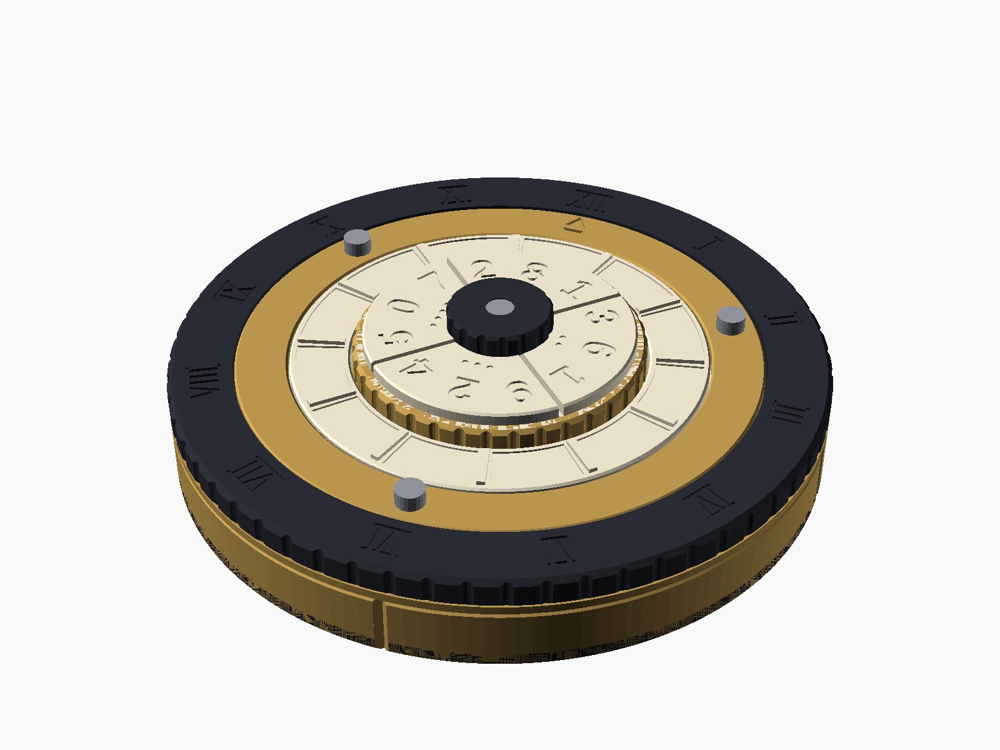
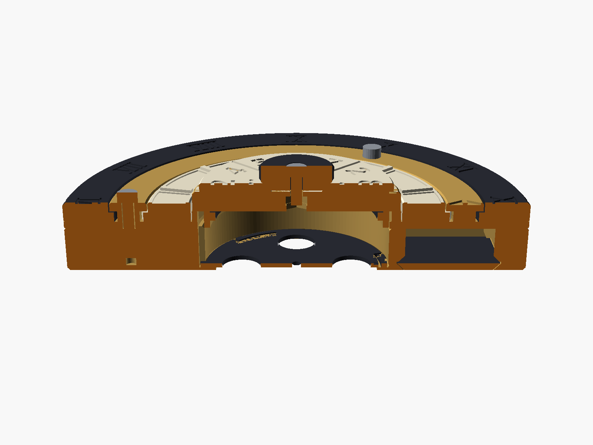
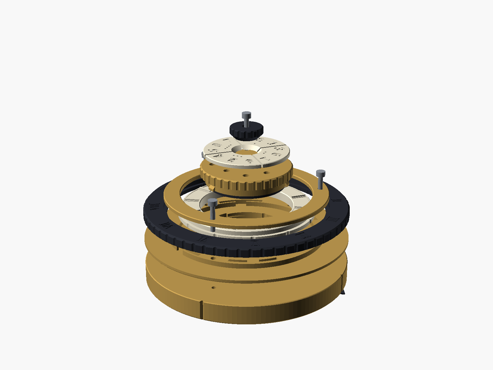

# The Chronometer

A 3D-printed mechanical puzzle instrument for *The Timekeeper's Paradox* (26 Nov 2026).
Two indexed dials, a removable centre cover over a stencil well, a hidden UV-flashlight
compartment and four dockable code fragments. Parametric OpenSCAD, support-free, M3 only.



| | |
|---|---|
|  |  |

**Status:** architecture reviewed, functional prototype geometry modelled, clearances
verified in CAD, paper sheets generated. **Nothing has been printed yet** — the next step is
the mechanical test print below. Decoration is deliberately minimal until that passes.

The reasoning behind the layout (and what was changed from the original brief) is in
[`docs/DESIGN_REVIEW.md`](docs/DESIGN_REVIEW.md).

## Repository

| Path | Contents |
|------|----------|
| `cad/chronometer.scad` | The whole model. Set `part` (or use the Customizer) to view/export any part. |
| `stl/` | One STL per part, already in print orientation, plus two convenience plates. |
| `sheets/aperture_test_sheet.pdf` | Clue sheet that reads **RIFT** through the mask (page 1 test, page 2 game copy). |
| `sheets/labels_and_templates.pdf` | Inner-dial symbol labels, UV insert discs, fragment template, demo decoding card. |
| `sheets/aperture_proof.png` | Simulated view through the mask, registered and 1 mm off. |
| `images/` | Assembled, back, section and exploded views. |
| `build.sh` | Re-exports STLs, renders images, runs the interference checks. |
| `scripts/make_sheets.py` | Regenerates the PDFs from the CAD parameters. |
| `docs/SYMBOL_TEST.md` | Experiment: printed dial symbols instead of stickers (separate test plate). |
| `docs/MATERIALS.md` | Materials, filament quantities (slicer-measured) and shopping list. |
| `docs/Chronometer_design_handoff.pdf` | Self-contained design brief for an outside reviewer (`scripts/make_handoff.py`). |

```bash
./build.sh            # STLs + checks + images  (needs openscad; ~1 min)
```

```bash
python3 scripts/make_sheets.py   # needs reportlab, pillow, pdftoppm
```

## Parts and print settings

Bambu Studio, 0.4 mm nozzle, **0.20 mm layers, 3 walls, 15 % gyroid, no supports, no brim**,
PLA. STLs are already oriented; do not rotate them. Suggested colours are only that.

| Part (per instrument) | Qty | Orientation as exported | Notes |
|---|---|---|---|
| `base` | 1 | back face down | Longest print (several hours, not yet sliced). One short 29 mm bridge (door-slot ceiling). Bay sized for the purple squeeze light. |
| `deck` | 1 | underside down | Wall order outer/inner for accurate journals. |
| `outer_ring` | 1 | face up | Numerals are 0.5 mm deep; paint-fill or colour-swap at the last 3 layers. Seam: aligned. |
| `inner_ring` | 1 | face up | 12 label pockets, 0.4 mm deep. |
| `index_cap` | 1 | face up | |
| `pawl_outer`, `pawl_inner` | 2 + 2 | flat | Start with the medium (1.2 mm) ones. PETG recommended for the final sets. |
| `cover` | 1 | face down | Smooth plate gives the best face. |
| `keystone` | 1 | top down | |
| `uv_ring` | 1 | flat | Holds the UV disc and is the cover's latch spring. Print spares. |
| `mask` | 1 | flat, marker up | Matte black. |
| `door` | 1 | back face down | |
| `fragment_1…4` | 4 | text down | Or print `plate_fragments`. With the AMS, paint the first 2 layers of the characters in a contrast colour. |

`plate_small_parts.stl` = keystone, UV ring and two of each pawl in three stiffnesses
(1.0 / 1.2 / 1.4 mm, marked I / II / III); `plate_springs.stl` is the PETG version with two
latch rings and no keystone. `test_seat`, `test_screw_ring` and `test_uv_bay` are fit-test
parts — see the build order below.

## Bill of materials (per instrument)

| Item | Qty | Use |
|---|---|---|
| M3 × 16 socket-head cap screw | 3 | index cap → deck → base (M3 × 20 is too long for the 12.2 mm base) |
| M3 × 8 socket-head cap screw | 1 | keystone |
| M3 hex nut | 1 | captive in the centre cover |
| Keychain UV squeeze light, 40.3 × 22.6 × 8.7 mm (caliper-measured) | 1 | key ring and split ring removed |
| Self-adhesive felt, ~6 × 40 mm | 2 | on the two long **side walls** of the bay, against rattle |
| Sticker paper / plain paper | — | dial labels, UV disc |

Screws self-tap into 2.8 mm printed pilots. For four instruments: 12 × M3×16, 4 × M3×8,
4 nuts. For heat-set inserts set `screw_pilot_d` to the insert's hole size.

## Assembly

1. **Keystone:** press the M3 × 8 screw through the keystone from the top until the head is
   seated in its bore (a drop of CA is fine here — it is not a moving joint).
2. **Cover:** start the nut on a long M3 screw passed through the cover from the face and
   draw it up into the hex pocket until it seats past the tight mouth; remove the screw. Lay a UV disc in,
   written side visible, and push the split ring in on top of it with its nub through the slot in the skirt. Screw the keystone on.
3. **Base:** stick felt to the two long side walls of the flashlight bay — never to the door
   or the roof, which must stay clear of the light's squeeze switch. Lay the light in flat. Slide the door in from the
   rim, grooves outward, until it clicks.
4. **Deck:** place the deck on the base. Drop the four pawls into their pockets, noses
   pointing at the rings: `pawl_outer` (nose on the convex side) in the two pockets that open
   outward, `pawl_inner` (nose on the concave side) in the two that open inward.
5. **Rings:** lower the inner ring, then the outer ring, each with a scallop over each pawl
   nose. They should drop in under light pressure.
6. **Index cap:** arrow at XII (the side opposite the lone screw). Three M3 × 16 screws,
   snug only — over-tightening strips PLA and can pinch the rings.
7. **Mask:** drop it into the well, marker up, key tab toward VI; it follows a groove down
   and clicks onto the ledge. To remove, push it up from the back.
8. **Cover:** lower with its mark ~1 hour anticlockwise of XII, twist clockwise to the stop.

## Using the four functions

- **Temporal Alignment** — turn the outer ring by its edge and the inner ring by its ribs;
  read both against the double arrow on the brass index ring.
- **Temporal Aperture** — twist the cover anticlockwise and lift. Set the instrument on the
  sheet, rim notches on the printed ticks (double notch = top), centre target visible in the
  sighting hole. Read clockwise from the mask's arrow.
- **Hidden UV Discovery** — on the back, push the grooved end of the panel toward the rim;
  the door slides out and the flashlight tips out. The UV message is inside the centre cover.
- **Final Synchronization** — unscrew the keystone, seat the four fragments (pegs fit one
  socket each), screw the keystone back. Home the inner ring as the final clue instructs and
  read the fragment character beside each named symbol: sun at the arrow, then moon,
  star, hourglass, diamond → **1147**.

## Prototype build order

Do not print four sets yet. The mechanisms are frozen only after one complete instrument
works. Everything in rounds 1–2 is small; every spring part is a consumable to reprint freely.

**Round 1 — fit tests (short prints).** Exact files, order, filament and Bambu Studio
settings are in [`docs/PRINT_PLAN.md`](docs/PRINT_PLAN.md), with the production plan.

| Print | Tests |
|---|---|
| `test_seat` (Ø66 × 9 mm) + `cover` + `mask` | cover bayonet, latch grooves, mask retention |
| `plate_springs` in PETG | detent springs in three stiffnesses, two latch rings |
| `deck`, `index_cap`, `test_screw_ring`, then `outer_ring`, `inner_ring` | rings, detents, cap |
| `plate_small_parts` + `plate_fragments` | PLA springs for comparison, keystone clamp, fragment keying |
| `test_uv_bay` + `door` | flashlight fit, door slide, bridge — only after calipering the light |

**Round 1 checks**

| Check | Pass | If not |
|---|---|---|
| Cover drops in at the insert position, turns the full 28° to the stop, lifts out again | no binding anywhere on the path | `bay_play_end` (0.30), `bay_play_free` (0.45), `cover_clear` (0.20) |
| Latch | audible click at both ends of the turn; cover stays locked when inverted and shaken; opens with a deliberate twist | `uv_ring_w` (1.6: thicker = firmer), `latch_depth` (0.7) |
| UV disc change | ring pulls out by its free end and presses back; **nut stays in the cover** | `nut_retain` (0.35: larger = tighter mouth) |
| Rings, pawls out, cap screws fully tightened | turn freely through all 12 positions; no rocking, rubbing or visible tilt | `ring_axial` (0.35), `ring_clear` (0.30) |
| Detents, each pawl thickness in turn | every position settles by itself; one finger turns the ring; nothing moves when shaken; repeat after ~200 clicks | pawl stiffness, then `notch_depth`, `pawl_preload` |
| Mask (real part, in the printed well) | slides down, clicks onto the ledge, stays when inverted, pushes out from the back, arms intact after 10 cycles | `mask_clear`; or `mask_style = "dropin"` |
| Fragments | each fits only its own socket; with the keystone tight all four are immovable when the cover is shaken and handled | `knob_clamp_gap` (0.3), `frag_clear` (0.20) |
| Flashlight bay and door | light drops in with the ring removed and does not switch on when the part is pressed or knocked; door slides, clicks, does not rub the bridge; spring survives 20 cycles | `uv_*` sizes, `door_clear`; or `uv_enabled = false` |

**Round 2 — one complete instrument.** Real `base`, stickers from
`sheets/labels_and_templates.pdf`, and `sheets/aperture_test_sheet.pdf` at 100 %. Then test it
as a player would, in ordinary indoor light:

- Read R-I-F-T through the well.
- Fit the four fragments and the keystone, set the **sun** (double-bordered label) to the
  index arrow, then read moon → star → hourglass → diamond. The sun is only the setting
  mark; four symbols give four characters: **1147**. Can a first-time reader tell which
  character each symbol points at, and read the 6.5 mm characters?

**Round 3 — freeze, then print the other three** plus spares: pawls, masks, UV rings, and a
door if the compartment is kept.

**Fallbacks already in the model**

- `mask_style = "dropin"` — loose keyed disc with a finger notch, no spring arms.
- `uv_enabled = false` — no bay and no door; the base becomes a plain 11 mm plate and the
  light is issued separately as a story prop. The UV puzzle (the disc inside the cover) is
  unaffected.

## Approved game configuration

Applied to the fragment characters and the printed sheets only; no mechanical geometry
depends on it.

- **Final answer:** 1147. Code ring clockwise from XII: `813619245072`. Tiles read
  281 / 361 / 924 / 507 (fragments 1–4). Decoys 6 and 9 kept pending a readability check.
- **Dial symbols, clockwise from XII:** sun, moon, key, flame, star, wave, mountain,
  hourglass, tree, compass, diamond, eye. Sun is the setting symbol (double-bordered label).
- **Aperture word:** RIFT (placement tolerance 1.7 mm). Page 2 of
  `sheets/aperture_test_sheet.pdf` is the same sheet without instructions or the answer.
- **UV disc:** "THE SUN IS FALSE. TRUST THE ARROW." in four lines of 4 mm capitals; fits the
  writable circle by calculation. Legibility with the real marker is still to be tested on
  the practice disc in `sheets/labels_and_templates.pdf`.
- **Final instruction (given separately):** "Place the false hour beneath the arrow. Then
  read the records in the order they were witnessed: Moon, Star, Hourglass, Diamond."

## Parameters worth knowing

All in the top block of `cad/chronometer.scad`, grouped for the Customizer.

| Parameter | Default | Meaning |
|---|---|---|
| `uv_w`, `uv_t`, `uv_len` | 22.6, 8.7, 40.3 | Flashlight width, thickness, length (caliper-measured). Base height follows `uv_t`. |
| `uv_clear`, `uv_z_clear`, `uv_end_gap` | 1.5, 1.5, 1.0 | Side, face and end clearance; face clearance keeps the squeeze switch untouched. |
| `bay_y`, `bay_x` | 41.5, 3.5 | Where the bay sits. A warning is echoed if it nears the rim, the well or a screw. |
| `body_r`, `well_r` | 62.5, 25 | Overall radius and well radius; the outer ring absorbs changes to `body_r`. |
| `apertures`, `aperture_d` | 4 × R15, 10.5 | Stencil holes `[x, y]`. Re-run `make_sheets.py` after changing. |
| `code_ring` | `813619245072` | The 12 fragment characters, clockwise from XII (approved game configuration). |
| `peg_radii_a/b` | — | Fragment keying. |
| `pawl_t`, `notch_depth`, `pawl_preload` | 1.2, 0.6, 0.15 | Detent strength. |
| `ring_clear`, `ring_axial`, `cover_clear`, `mask_clear`, `door_clear`, `frag_clear` | — | Fits. |
| `bay_play_free`, `bay_play_end` | 0.45, 0.30 | Cover bayonet axial play at entry / when locked (a running fit). |
| `latch_depth`, `uv_ring_w` | 0.7, 1.6 | Cover latch travel and spring stiffness. |
| `knob_clamp_gap` | 0.3 | Gap left under the keystone when its cone is seated on the fragments. |
| `nut_retain` | 0.35 | How much the nut-pocket mouth is under size. |
| `mask_style`, `uv_enabled` | `"spring"`, true | Fallbacks: drop-in mask; no integrated flashlight bay. |
| `cap_screw_style` | `"cap"` | `"csk"` for flush countersunk screws. |
| `cover_proud` | 3 | Grip height of the cover above the dials. |
| `show_numerals` | true | Roman numerals on the outer ring. |

Override from the command line without editing the file:

```bash
SCAD_ARGS="-D uv_w=23.6 -D uv_t=8.9" ./build.sh
```

## Needs physical validation

1. **Flashlight fit** — the bay is sized to caliper measurements (40.3 × 22.6 × 8.7 mm) with
   1.5 mm clearance. Confirm on the `test_uv_bay` print that the light drops in and does not
   switch on when the instrument is squeezed or set down hard.
2. **Detent feel and life** — force is estimated (~2–3 N at the rim), not measured. Check
   after ~200 clicks, and after a ring has been left between positions overnight (PLA creep).
3. **Cover latch** — the bayonet is now a loose running fit; retention is the spring nub on
   the UV ring. Its force (~1–2 N estimated) and click are untested.
4. **Mask retention** — spring-arm preload (0.35 mm) and the click groove are untested.
5. **Door** — click strength of the side spring, and whether the bridged ceiling sags
   enough to rub (0.5 mm allowed).
6. **Deck-to-base seam near XII** — the 120° between the two upper screws spans the
   flashlight bay; check the rim stays closed there.
7. **Self-tapped M3 in PLA** — fine for a few assembly cycles; if the units will be opened
   often, switch to heat-set inserts.
8. **Legibility** — 6.5 mm fragment characters and 6 mm numerals as printed; aperture
   reading down a 22 mm well in poor light.
9. **Keystone screw** — the press fit of the screw head (`knob_head_d` 5.4) varies with
   screw brand.
10. **Printed-paper scale** — confirm the 100 mm bar on each sheet before judging alignment.

## After the test print

Feed back measurements and impressions; then: tune fits, and add the visual layer (minute track, engraved borders, AMS colour inlays, final
symbol set and code).
