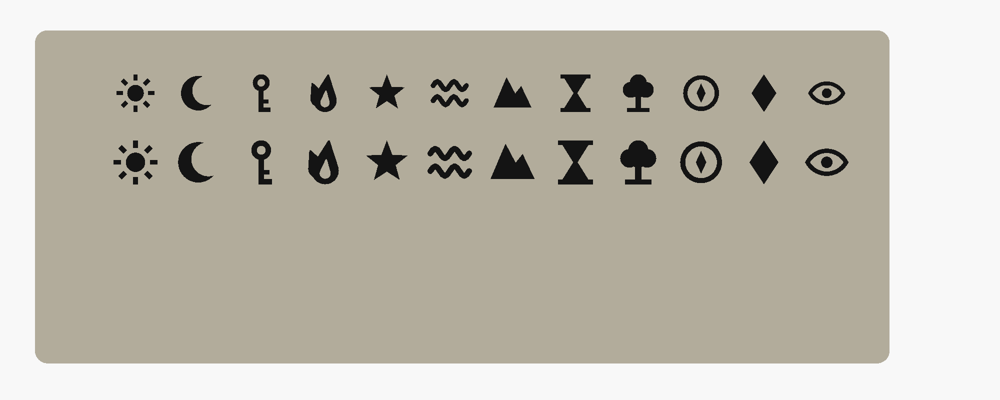

# Printed dial symbols — test plate

An experiment in replacing the inner ring's sticker labels with symbols printed into the
ring. **The production model is untouched**: the test is a separate file
(`cad/symbol_test.scad`), and the inner ring still has its label pockets.

## What to print

One plate, 136 × 53 × 2 mm, printed face up exactly as the inner ring prints.

| File | Filament |
|---|---|
| `stl/symbol_test_body.stl` | SUNLU Matte Bone White PLA |
| `stl/symbol_test_inlay.stl` | Matte black PLA |

| Row (dots at the left) | Approach | Symbol size |
|---|---|---|
| 1 | Flush two-colour inlay, 0.4 mm deep | 6 mm |
| 2 | Flush two-colour inlay, 0.4 mm deep | 7 mm |
| 3 | Recessed 0.4 mm, for paint-fill | 6 mm |
| 4 | Recessed 0.6 mm, for paint-fill | 6 mm |

Left to right is clockwise on the dial: sun, moon, key, flame, star, wave, mountain,
hourglass, tree, compass, diamond, eye. The render shows only rows 1 and 2; rows 3 and 4 are
the same symbols as open recesses.

The 7 mm row is there because the label area on the ring is about 9 mm wide, so a slightly
larger symbol fits if 6 mm proves marginal.

Sliced weight 17 g; about 2¼ hours by the generic PrusaSlicer profile (it is nearly solid
and full of small outlines), plus the filament changes. Bambu Studio's figure will differ.

### Bambu Studio steps

1. Drag both STLs in together. When asked whether to load them as a single object with
   multiple parts, answer **Yes**. They are already aligned; do not move either one.
2. In the object list, assign the bone-white filament to `symbol_test_body` and black to
   `symbol_test_inlay`.
3. 0.20 mm layers, 3 walls, top shell 5 layers, top surface pattern monotonic,
   **ironing off** (ironing drags black into the white), supports off, prime tower on.
4. Leave flushing volumes on auto-calculate. Note the "flushed" weight Bambu Studio reports
   after slicing — that is the real purge figure for your two spools.
5. Textured PEI, filament profiles for the spools you load.

### Design rules used for the symbols

Every solid stroke is at least 0.6 mm wide and every gap at least 0.5 mm at the 6 mm size,
so each feature is at least one and a half nozzle widths. The six shapes most at risk of
confusion were made structurally different rather than just differently proportioned:

| Symbol | Distinguishing structure |
|---|---|
| Star | Five points, solid |
| Diamond | Tall solid rhombus, four corners, nothing around it |
| Compass | Ring with a slim needle inside |
| Mountain | Wide flat base, two unequal peaks |
| Tree | Rounded canopy on a trunk with a ground bar |
| Flame | Teardrop with a side tongue and a hollow centre |

## Does 7 mm fit the ring?

Yes, comfortably, measured on the current inner ring (no change made to it):

| | 6 mm | 7 mm |
|---|---|---|
| Radial margin inside the label area (9 mm wide) | 1.5 mm each side | 1.0 mm each side |
| Radial margin to the edge of the flat ring face | 2.3 mm | 1.8 mm |
| Clearance to the finger rib on each side | 4.3 mm | 3.7 mm |

**7 mm is the size to evaluate first.** Feature sizes for the three symbols most likely to
lose detail:

| Feature | at 6 mm | at 7 mm |
|---|---|---|
| Key: hole in the bow | Ø1.2 mm | Ø1.4 mm |
| Key: teeth | 0.66 mm | 0.77 mm |
| Compass: ring width | 0.69 mm | 0.81 mm |
| Compass: gap between needle tip and ring | 0.60 mm | 0.70 mm |
| Flame: hollow centre | Ø1.5 mm | Ø1.8 mm |

## What to look at

Judge the 7 mm row first, at arm's length, then in dim lighting. A final check with the
dial assembled comes later, once a ring has been made with printed symbols.

- Can each of the twelve be named at arm's length in ordinary indoor light? Give the plate
  to someone who has not seen the list.
- Row 1 against row 2: is 6 mm enough, or is 7 mm clearly better?
- Fine features: sun rays, key teeth, eye outline, compass needle, flame hollow.
- Flush rows: black smeared into the white, white specks in the black, raised or sunken
  inlays.
- Recessed rows: paint one half of each row. Does wiping stain the matte white around the
  symbol? Is 0.4 mm deep enough to hold paint, or is 0.6 mm needed?

## Estimates for four complete rings

These are estimates, not slicer output; only the base ring time is measured.

**Flush two-colour (AMS)**

- The symbols occupy only the top two layers of the ring face, so the whole print has
  about two to four filament changes — and that count is per plate, not per ring. Four
  rings on one plate cost the same changes as one ring.
- Purge: black-to-white is the expensive direction. Expect very roughly 0.3–1 g per change,
  so about 1–4 g of purge plus a small prime tower of a few grams, for all four rings
  together. Bambu Studio's flushed figure from the test plate will tell you the real number
  per change.
- Black actually deposited in the symbols: under 0.1 g per ring.
- Time: four rings are about 4 h 40 by the generic profile; the changes add roughly
  5–10 minutes in total.

**Recessed and paint-filled**

- No AMS use and no purge; print time unchanged.
- Hand work: fill and wipe 12 symbols per ring, perhaps 10–15 minutes each plus drying.
- Risks: paint staining the matte surface, uneven fill, and wear from fingers on the ring.

**Expectation.** Flush inlay should be the better result: crisp, permanent, nothing to wear
off, and almost free in purge when all four rings share a plate. Paint-fill is the fallback
if the AMS result is smeared. Neither is confirmed until this plate is printed.

## If the test passes

The symbols would go on the top face of the inner ring between the finger ribs, replacing
the label pockets. That face is not a mating surface: the bore, the flange, the detent
scallops and the outside dimensions stay exactly as they are. The label-pocket ring remains
available as a switchable fallback.

## Fallback: stickers with a laser printer

If printed symbols are not adopted, `sheets/labels_and_templates.pdf` still applies, but
buy **laser-compatible** matte label sheets. Inkjet vinyl must not go through a laser
printer; the fuser can melt it.
